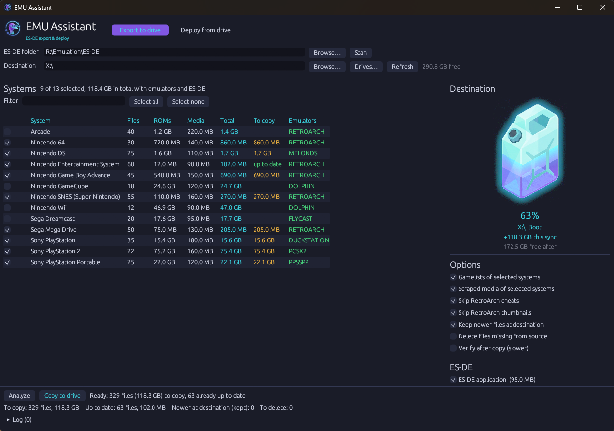
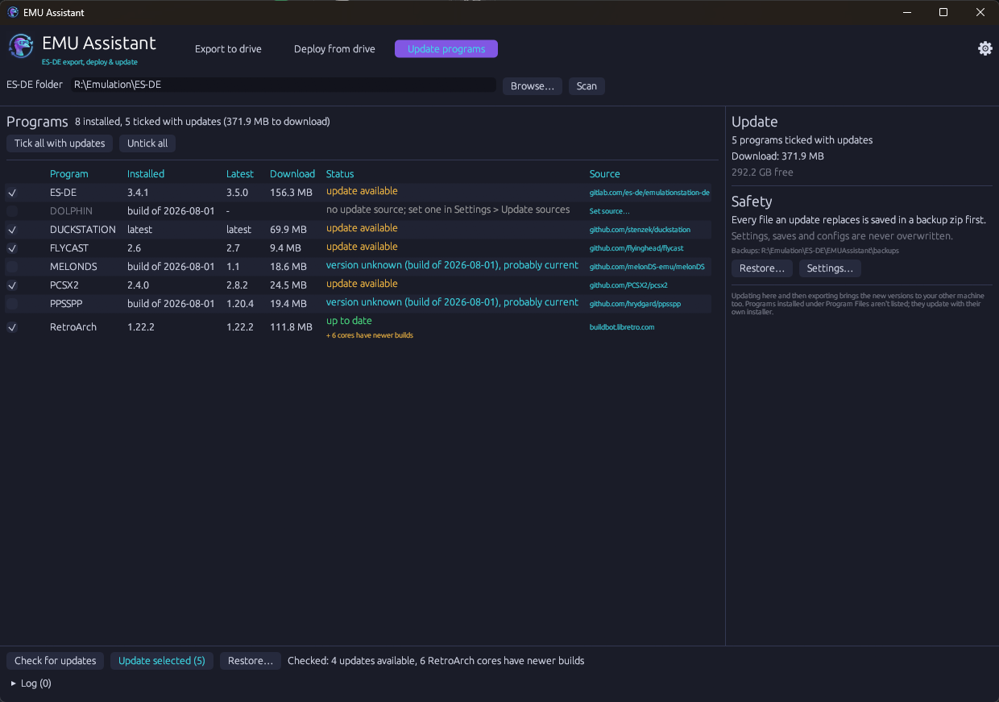
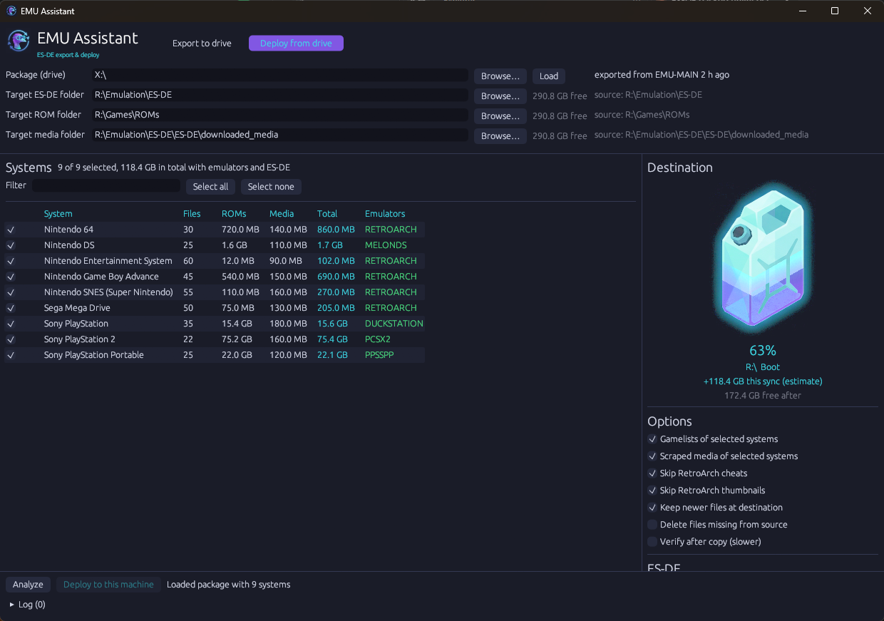
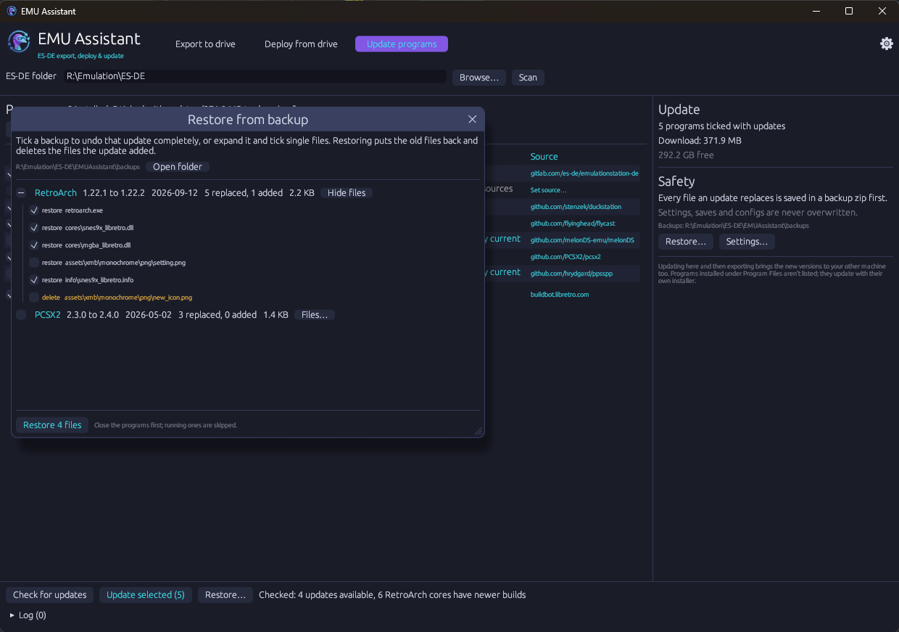
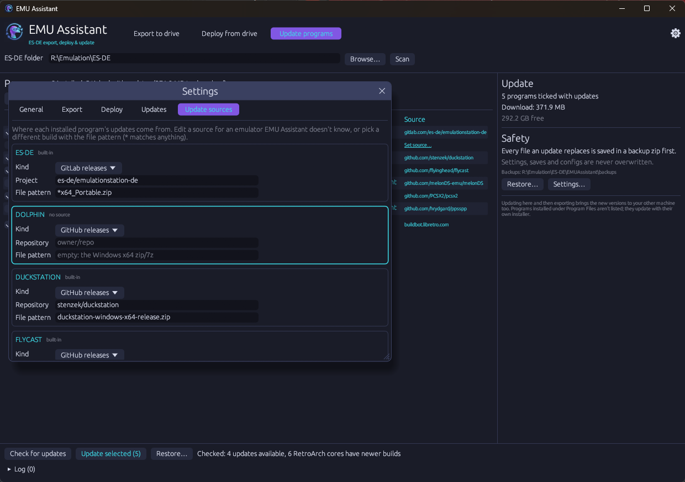
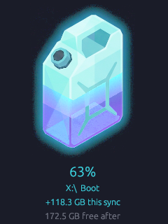
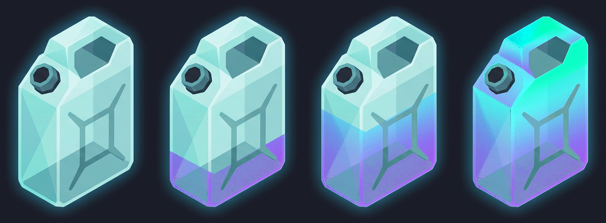
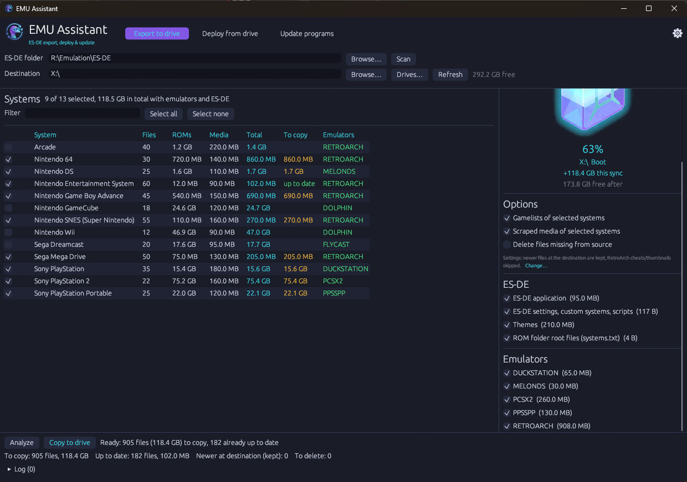

<p align="center">
  
</p>

<h1 align="center">EMU Assistant</h1>

<p align="center">
  <a href="https://github.com/chucklingkoala/EMU-Assistant/actions/workflows/build.yml"></a>
  <a href="https://github.com/chucklingkoala/EMU-Assistant/releases/latest"></a>
</p>

<p align="center">
  Pack up your <a href="https://es-de.org">ES-DE</a> setup and take it with you.<br>
  Pick the consoles you want, copy them to an external drive, then deploy them on a handheld or second PC: ROMs, emulators, BIOS, scraped media, ES-DE and all.<br>
  Saves made on the handheld come back the same way. It also keeps ES-DE, RetroArch and your emulators up to date, with a backup of every update.
</p>

<p align="center">
  <br>
  
</p>

---

## What it does

Say your main emulation box has terabytes of games, and your handheld (a ROG Ally, Legion Go, Steam Deck running Windows…) has room for only some of them. EMU Assistant moves that subset for you:

1. **Export:** on the main machine, tick the consoles you want. EMU Assistant works out which emulators those consoles use and copies everything to an external drive. This covers the ROMs, the emulators (with their BIOS files, configs and saves), the scraped media, the gamelists and ES-DE itself. Folder paths stay the same.
2. **Deploy:** plug the drive into the handheld and run `EMUAssistant.exe` from the drive. It copies everything into place and points ES-DE at the new ROM folder.
3. **Bring back:** saves and save states made on the handheld travel back to the main machine over the same drive, with a backup of every save they replace.
4. **Update:** check for newer builds of ES-DE, RetroArch (and its cores) and your portable emulators, and install the ones you tick. Every file an update replaces is saved in a zip first, so you can roll it back.

Copies are **incremental and resumable**. Files that are already up to date are skipped, and an interrupted copy picks up where it stopped. **Newer files at the destination are never overwritten**, so save games made on the handheld are safe until you bring them back.

## Features

- **Console picker** listing every ES-DE system that has games, with file count, ROM size, media size and the total space each one needs.
- **Pick single games** of a system, e.g. only the Switch games you're playing right now. Their updates and DLC from `_Updates` come along automatically.
- **Profiles** for several devices: one selection for the ROG Ally, another for the Legion Go, on one shared drive or a drive each. Deploy on each device ticks its own part.
- **Bring saves back** from the handheld to the main machine: saves and save states are found in the emulator folders and ticked for you, and every save they replace is kept in a backup zip.
- **Automatic emulator detection** using ES-DE's own `es_systems.xml` and `es_find_rules.xml`. It respects the alternative emulators you picked in ES-DE, for a whole system or for individual games.
- **Fuel-can gauge** showing how full the destination drive will be after the sync, and a warning before you run out of space.
- **Mirrored paths:** `D:\Games\ROMs\snes` on the main box becomes `E:\Games\ROMs\snes` on the drive.
- **Relocatable deploy:** put ES-DE on `C:` and the ROMs on an SD card if you like. `es_settings.xml` is updated to match.
- **Safe syncing:**
  - Files are skipped when size and modified time already match.
  - Copies are written atomically, so an interrupted run never leaves a half-written file under its real name.
  - Newer files at the destination are kept, and an optional verify pass re-reads each copy.
  - Small files (scraped media, configs) are copied four at a time, which is several times faster on drives with tens of thousands of them.
- **Skip the bulk you don't need:** RetroArch's cheat database and its menu thumbnails can be left out. Both can be downloaded again from RetroArch's online updater.
- **Mirror mode (optional):** deletes ROMs and media at the destination that you've removed at the source. It always asks first.
- **Program updates:** finds the newest release of ES-DE, RetroArch and the portable emulators you have installed, and updates only the ones you tick. RetroArch cores can be updated too. Settings and saves are never overwritten, and a backup zip lets you undo an update, completely or file by file.
- **Settings (⚙):** preferences that don't change from run to run live behind the cog in the top right corner and are remembered.
- **Keeps itself up to date:** tells you when a new EMU Assistant is out and updates itself with one click. The download is checked against the SHA-256 checksum published with the release.
- **Scheduled syncs:** `EMUAssistant.exe --export` copies the saved selection without opening the window (see [Tips & troubleshooting](#tips--troubleshooting)).
- **A single small `.exe`** with no installer and no runtime. It remembers your last selection.

## Requirements

- Windows 10 or 11 on both machines.
- The **portable** release of ES-DE (the folder containing `ES-DE.exe`, with `Emulators\` next to it). The ROM folder can live anywhere: inside the ES-DE folder, or somewhere separate such as `D:\Games\ROMs`.
- An external drive large enough for your selection. NTFS is recommended. exFAT works for copying, but ES-DE itself runs slowly from exFAT (see the ES-DE user guide). FAT32 can't hold files of 4 GB or more; EMU Assistant warns before copying.

## Getting started

Download `EMUAssistant.exe` from the [latest release](https://github.com/chucklingkoala/EMU-Assistant/releases/latest) (or [build it yourself](#building-from-source)) and run it on your main emulation machine. It needs no installation.

> Put `EMUAssistant.exe` in your ES-DE folder (next to `ES-DE.exe`) and it finds your setup automatically. Otherwise, click **Browse…** and pick the ES-DE folder.

### 1. Export to the drive (main machine)


1. **ES-DE folder:** pick the folder that contains `ES-DE.exe`, then press **Scan**. Your ROM and media folders are read from ES-DE's settings, so a custom ROM path is picked up automatically.
   Feeding more than one device? See [Profiles](#profiles-one-selection-per-device).
2. **Destination:** pick the external drive with **Drives…**, or browse to a folder.
3. **Tick the consoles** you want. The **Total** column shows how much space each one needs, and the emulators they use appear on the right. To take only some games of a console, click its **Games** button (see [Choosing games](#choosing-games)).
4. Press **Analyze**. EMU Assistant compares your setup with the drive:
   - The **To copy** column shows what's missing or changed; *up to date* means nothing needs copying.
   - The status bar shows the totals: files to copy, files already up to date, and newer files at the destination that will be kept.
   - The fuel can shows exactly how full the drive will be.
5. Press **Copy to drive**. You can **Cancel** at any time and run it again later; it continues where it left off.

When the copy finishes, the drive contains:

```
E:\
├── EMUAssistant.exe           ← the app, ready for the other machine
├── EMUAssistant\manifest.json ← what was exported, and from where
├── Emulation\ES-DE\...        ← ES-DE, Emulators\, gamelists, media (same paths as the source)
└── Games\ROMs\...             ← only the consoles you selected
```

#### Choosing games

Click the **Games** button of a system (it shows `50 games`) to open the game picker. Tick the games you want, then press **Done**. The button then shows `12 / 50 games`, and the sizes and the fuel can follow your picks. Your picks are remembered.

- **Updates and DLC come with their game.** Files in a folder such as `_Updates`, `_DLC` or `Updates` are matched to their game by title ID (Switch, Switch 2) or serial (PlayStation, e.g. `CUSA00001-UPDATE`). Files without an ID are matched by name, so `Super Mario Bros Wonder v1.1.0.nsp` goes with `Super Mario Bros. Wonder.nsp`. Hover over *+ 3 updates/DLC* to see which files were matched. A file that matches no game is listed as a game of its own.
- **Shared folders are always copied.** Other folders starting with `_`, such as `_Firmware` and `_Keys`, go with every selection.
- **One game, all its files.** A game folder (PS3, Wii U, PS4), a `.cue` sheet with its tracks, or an `.m3u` playlist with its discs counts as one game.
- **Scraped media** is copied for the picked games only. The gamelist is copied whole.
- **Unticked games stay on the drive.** Unticking a game only stops it being copied. Games already on the drive are kept, even with *Delete files missing from source* on. To swap games on a small drive, delete the old ones from the drive yourself.
- **Select all** in the picker goes back to copying every game, including games you add later.

The picker also works in **Deploy** mode, where it lists the games on the drive, so you can put only some of them on the handheld.

Exporting again later only copies what changed. Selecting more consoles adds them to the same drive. Drives exported with an older version (which used `EMU Assistant\` and `EMU Assistant.exe`) are still recognized and are switched to the new names on the next export.

#### Profiles: one selection per device

A profile remembers a selection under a name: the ticked consoles, picked games, emulator choices, the ES-DE parts, the media and gamelist switches, and the destination. Use the **Profile** row above the ES-DE folder:

- **New…** saves what is on screen under a name, e.g. `ROG Ally`. From then on, changes you make are kept in that profile.
- Pick another profile in the list to switch: its consoles, games and destination come back. **(none)** leaves the current selection as it is without a profile.
- **Rename…** and **Delete** act on the profile in the list. Deleting forgets the profile; the selection on screen stays.

Profiles work with one drive for all devices and with a drive per device. When you export under a profile, the drive records that profile's selection. Deploy then offers a **Profile** choice: pick `ROG Ally` and only the Ally's consoles, games and emulators are ticked. The handheld remembers its profile for next time. **Everything on the drive** ticks everything, as before.

With two profiles on one drive, a console's size shown in Deploy before Analyze is the one from the last export of that console; Analyze is exact.

### 2. Deploy from the drive (handheld / second PC)



1. Plug in the drive and run **`EMUAssistant.exe` from the drive**. It opens in **Deploy** mode with the package already loaded.
2. Check the **target folders**. They default to the same paths as on the main machine, but each one can be changed. For example, ROMs can go to an SD card while ES-DE stays on `C:`. Changing the ES-DE folder moves the ROM and media folders with it if they were inside it.
3. Untick any consoles you don't want on this machine.
4. Press **Analyze**, then **Deploy to this machine**.

If the ROM or media folder ends up somewhere different from the main machine, EMU Assistant updates `ROMDirectory` and `MediaDirectory` in the target's `es_settings.xml`. The original is kept as `es_settings.xml.emuasist-bak`. Start ES-DE and play.

The target folders you chose are remembered on this machine, so the next deploy from the same main machine uses them again.

If the drive was exported under [profiles](#profiles-one-selection-per-device), pick this device's profile in the **Profile** row first.

### 3. Bring saves back (handheld to main machine)

Deploy never overwrites a newer file, so saves made on the handheld stay there. The **Bring back** tab carries them home in two hops over the same drive:

1. **On the handheld:** run `EMUAssistant.exe` from the drive, open **Bring back**, and press **Find changes**. The direction is *this machine to the drive*. Press **Bring back** to copy the ticked files to the drive.
2. **On the main machine:** plug in the drive, open **Bring back** (the direction is now *the drive to this machine*), press **Find changes**, then **Bring back**.

What is listed and what is ticked:

- Only the **emulator folders** are compared: files that are new or newer on the side they come from. ES-DE, its settings, the ROMs and the gamelists never travel back.
- **Saves** are ticked for you: save folders such as `saves`, `states`, `memcards`, `savedata`, Dolphin's `GC` and `Wii`, and save files such as `.srm`, `.sav`, `.mcd`, `.gci`.
- **Settings** (`.ini`, `.cfg`, `.yml`, …) and **other files** are listed unticked, grouped per emulator, so you can pick them. A handheld's settings usually don't belong on the main machine.
- Caches, shaders, logs, RetroArch's cheats and thumbnails are left out.
- Emulators that are running are skipped; close them and press **Bring back** again.

On the main machine, every save that is about to be replaced is first put in a backup zip in the same backups folder the updates use (one zip per emulator, the last 3 per emulator kept). To undo, press **Restore…** in the Bring back tab and tick the backup, or expand it and tick single saves.

### 4. Update programs


1. Open the **Update programs** tab. It lists ES-DE and every emulator that ES-DE's find rules locate on this machine. Emulators that aren't installed don't appear and are never checked.
2. Press **Check for updates**. For each program you'll see the installed version, the latest release and the download size.
   - *version unknown*: the program doesn't record its version. EMU Assistant compares build dates to say whether it is probably current. After one update through EMU Assistant the version is known.
   - Programs under `Program Files` were installed with an installer and aren't listed; they're left to their own updater. Launchers such as Steam aren't listed either.
3. **Tick the programs to update.** Nothing is ticked for you. *Tick all with updates* ticks only the programs with a known newer version. For RetroArch, cores that have newer builds are updated along with it.
4. Press **Update selected**. For each program EMU Assistant downloads the release, unpacks it, saves every file it is about to replace in a backup zip, then installs. If anything goes wrong mid-way, the backup is put back automatically.

What's never overwritten: existing `.ini`, `.cfg`, `.yml` and `.toml` files, `portable.txt`, RetroArch's `config`, `saves`, `states`, `system`, `playlists` and `screenshots` folders, and ES-DE's own `ES-DE`, `ROMs` and `Emulators` folders.



**Rolling back:** press **Restore…**, tick a backup to undo that update completely, or expand it and tick single files. Restoring puts the replaced files back and deletes the files the update added. Backups go to `<ES-DE folder>\EMUAssistant\backups` (one zip per program per update, the last 3 per program are kept). That folder stays on this machine and isn't exported.

Update on your main machine, then export: the new versions travel to the drive and the handheld like any other change.

#### Where updates come from

| Program | Source |
|---|---|
| ES-DE | ES-DE releases on GitLab (portable zip) |
| RetroArch | stable builds from buildbot.libretro.com; cores from its nightly builds, like RetroArch's online updater |
| ares, Azahar, Cemu, DOSBox-Staging, DOSBox-X, DuckStation, Flycast, Gearboy, jgenesis, melonDS, Mesen, mGBA, NooDS, Panda3DS, PCSX2, PPSSPP, RPCS3, SameBoy, shadPS4, simple64, Snes9x, Stella, VBA-M, Vita3K, xemu, Xenia Canary, Ymir | the project's GitHub releases |
| Eden | Eden's releases at git.eden-emu.dev |



Stable releases are used where a project has them; projects that only publish rolling builds get their newest build. For any other emulator, or to choose a different build (e.g. Eden's ROG Ally build), open **⚙ Settings > Update sources** and set a GitHub, GitLab or Gitea/Forgejo repository, or a direct download link, plus an optional file pattern such as `*windows-x64*.zip`.

GitHub allows 60 requests an hour without signing in. A check takes one request per program from GitHub (two the first time for projects that only publish test builds). If you hit the limit, add a GitHub token (no permissions needed) under **⚙ Settings > Updates**. EMU Assistant remembers GitHub's answers and asks whether they are still current; with a token, GitHub doesn't count such "unchanged" answers against the limit.

A download that is cut off (a dropped Wi-Fi connection, for example) continues where it stopped, also when you start the update again later.

### Updating EMU Assistant itself

EMU Assistant checks GitHub for a newer release each time it starts. When there is one, an **Update to x.y.z** button appears next to the version number in the top right corner. It opens the release notes, and **Update and restart** downloads the new version, swaps it in for the running one and restarts. Only `EMUAssistant.exe` is replaced. The old exe is kept as `EMUAssistant.exe.old` until the new one has started, then removed.

Before the swap, the download is checked against the SHA-256 checksum published with the release (and its size and version). If they don't match, nothing is replaced.

**From the drive to the handheld:** when you run the drive's `EMUAssistant.exe` on another machine and that machine has an older EMU Assistant (the one you last ran there, or the one in its ES-DE folder), it asks whether to replace it with the newer version from the drive.

Turn the startup check off, or check by hand, under **⚙ Settings > General**. Versions up to 0.3.0 can't update themselves, so download 0.4.0 once from the [releases page](https://github.com/chucklingkoala/EMU-Assistant/releases/latest).

## The fuel can

The **Destination** panel shows how full each target drive will be once the sync completes:

<p align="center">
  
  &nbsp;&nbsp;
  
</p>

- The **lower, darker liquid** is what's already on the drive.
- The **brighter, gently pulsing layer** on top is what this sync will add.
- The caption shows the fill level after the sync, how much this sync adds, and how much will be left free.
- Before you press Analyze, the numbers are an **estimate**: everything selected, as if nothing were on the drive yet. After Analyze they're exact.
- If the sync won't fit, the can turns red, shows **WON'T FIT** with the shortfall, and the copy button is disabled.
- When deploying to two drives (e.g. `C:` and an SD card), you get one can per drive.

## Options



The side panel holds the choices you make for each run:

| Option | Default | What it does |
|---|---|---|
| Gamelists of selected systems | on | Copies `ES-DE\gamelists\<system>` (game metadata, favourites, play counts). |
| Scraped media of selected systems | on | Copies `downloaded_media\<system>` (box art, screenshots, videos) for the **selected consoles only**. |
| Delete files missing from source | off | Mirror mode for **ROMs and media only**. Removes destination files you've deleted at the source. Emulators and ES-DE files are never deleted. You'll see the list and must confirm. Folders left empty by this are removed too. |

### Settings (⚙)

Preferences that stay the same from run to run are behind the **cog** in the top right corner. They're saved straight away.

| Tab | Setting | Default | What it does |
|---|---|---|---|
| General | Keep newer files at destination | on | Never overwrites a file that is newer at the destination, e.g. saves or configs changed on the handheld. Such files are listed after Analyze. |
| General | Verify after copy | off | Re-reads every copied file and compares it byte for byte with the source. |
| General | Check for EMU Assistant updates at startup | on | Looks for a newer release on GitHub when the program starts (see [Updating EMU Assistant itself](#updating-emu-assistant-itself)). |
| Export / Deploy | Skip RetroArch cheats | on | Leaves out RetroArch's cheat database (tens of thousands of small files). |
| Export / Deploy | Skip RetroArch thumbnails | on | Leaves out RetroArch's own menu thumbnails. ES-DE doesn't use them. |
| Export | Copy EMUAssistant.exe to the drive | on | Puts the app on the drive, ready to deploy on the other machine. |
| Deploy | Update ES-DE's ROM and media folders | on | Points `es_settings.xml` at the new ROM and media folders when they moved. |
| Updates | Back up replaced files (zip) | on | Saves the files an update replaces so it can be restored. |
| Updates | Update RetroArch cores | on | Also updates the cores already in RetroArch's `cores` folder. |
| Updates | Keep the last N backups per program | 3 | Older backups are deleted (0 keeps all). Saves backups from Bring back are counted apart from update backups. |
| Updates | Backup folder | `<ES-DE>\EMUAssistant\backups` | Where the backup zips go. |
| Updates | GitHub token | — | Optional, for more than 60 checks an hour. `GITHUB_TOKEN` is used when set. |
| Update sources | per program | built-in | Where each program's updates come from (see [Where updates come from](#where-updates-come-from)). |

**ES-DE section:** choose whether to copy the ES-DE application itself, its settings and custom systems, your themes, custom collections, and the small files in the root of the ROM folder.

**Emulators section:** lists the emulators used by the selected consoles.
- Emulators in active use are ticked automatically. Emulators that are only configured as an alternative are shown dimmed, and you can tick them.
- Hover over an emulator to see its folder and which consoles use it.
- An emulator shown with an **x** can't be copied, and the reason is given. Usually it isn't installed, or it's a Windows component such as `cmd.exe` used for script launchers.

## What gets copied

| Item | Source | Notes |
|---|---|---|
| ROMs | `<ROM folder>\<system>` | Only the consoles you tick, or only the games you pick, with their updates/DLC. |
| Gamelists | `ES-DE\gamelists\<system>` | Optional. |
| Scraped media | `ES-DE\downloaded_media\<system>` (or your custom media folder) | Optional, only for selected consoles. |
| Emulators | The emulator's folder, as found by ES-DE's find rules | The whole folder, so **BIOS files, configs, cores and saves come along**. Shared emulators like RetroArch are copied once. |
| ES-DE | The ES-DE folder | Without `Emulators\`, ROMs, media, gamelists and logs, which are handled separately. |
| ES-DE settings | `ES-DE\settings`, `custom_systems`, `scripts`, … | |
| Themes, collections | `ES-DE\themes`, `ES-DE\collections` | |

**Not copied:** consoles you didn't tick and their media; ES-DE logs; RetroArch cheats and thumbnails (unless you untick those options); emulators that resolve to Windows system folders.

Emulators that live **outside** the ES-DE folder are still copied, to the same path on the drive and target. Ones under `Program Files` are left unticked by default, because installed programs usually need their installer.

## How syncing works

- **Skip:** a file is skipped when the destination already has it with the same size and modified time. A 2-second tolerance covers FAT/exFAT timestamps.
- **Resume:** each file is written as `name.emuasist-part` and renamed only once it's complete. Cancel or unplug at any time; the next run redoes only the unfinished files and continues.
- **Small files in parallel:** files under 1 MB are copied four at a time, then the large ones one by one. Each file still goes through the part file and rename above.
- **Newer wins:** with *Keep newer files* on, a destination file newer than the source is left alone and listed for you.
- **Long paths:** paths over 260 characters are handled.
- **Re-check:** after every copy, EMU Assistant re-analyzes automatically so the columns and gauge reflect the drive's real state.

## Tips & troubleshooting

- **An emulator shows "not installed":** ES-DE couldn't find it with its find rules either. Check that it's in the `Emulators\` folder under the name ES-DE expects (see the ES-DE user guide).
- **A system is missing from the list:** only systems with at least one game file are shown. Folders containing only `systeminfo.txt` don't count.
- **`noload.txt`:** systems that ES-DE skips because of a `noload.txt` file are flagged in the list.
- **Check what EMU Assistant sees without the GUI:**
  ```
  EMUAssistant.exe --dump "D:\Emulation\ES-DE"
  ```
  This prints the detected ROM and media folders, every system with its emulators, and where each emulator was found. Add `--games` to also list every game with the updates and DLC matched to it.
- **Check for updates without the GUI:**
  ```
  EMUAssistant.exe --check-updates "D:\Emulation\ES-DE"
  ```
- **Export without the GUI** (for a scheduled sync):
  ```
  EMUAssistant.exe --export [--profile "ROG Ally"] [--dest E:\] ["D:\Emulation\ES-DE"]
  ```
  This exports the selection you last used in the window, or the profile's, to its destination. It copies only and never deletes anything on the drive, even if *Delete files missing from source* was on. The exit code is 0 when it finished, 1 when some files failed, and 2 when it didn't start (no such profile, the drive isn't plugged in, not enough space). Each run writes a log to `%APPDATA%\EMUAssistant\logs` (the last 10 are kept).
  To run it every night with Windows Task Scheduler: `schtasks /create /tn "EMU Assistant export" /sc daily /st 03:00 /tr "\"C:\Tools\EMUAssistant.exe\" --export --profile \"ROG Ally\""`.
- **An update says the download doesn't contain the program:** the project changed its file names. Open **⚙ Settings > Update sources** and adjust the file pattern.
- Your last ES-DE folder, destination, selection, profiles and settings are remembered in `%APPDATA%\EMUAssistant\config.json`. Settings from earlier versions (`%APPDATA%\EMU Assistant`) are picked up automatically. To keep them somewhere else (for a test, or a portable setup), set the environment variable `EMUASSISTANT_CONFIG_DIR` to a folder.

## Building from source

Requires Rust (stable) on Windows. To embed the exe icon on the GNU toolchain, `windres` must be on `PATH`; without it the build still works but the exe uses the default icon.

```
git clone https://github.com/chucklingkoala/EMU-Assistant.git
cd EMU-Assistant
cargo build --release
# -> target\release\EMUAssistant.exe
cargo test
```

**Releasing a new version:** set `version` in `Cargo.toml` (e.g. `0.5.0`), commit and push, then push a matching tag (`git tag v0.5.0` and `git push origin v0.5.0`). The build workflow checks that the tag matches `Cargo.toml`, builds the exe and publishes the release with its SHA-256 checksum. Every copy of EMU Assistant offers the update on its next start.

**Signing:** a signed exe shows the publisher instead of a SmartScreen warning. The build workflow signs the exe when two repository secrets are set: `SIGNING_CERT_PFX` (the code signing certificate as a `.pfx` file, base64-encoded) and `SIGNING_CERT_PASSWORD`. Without them the step is skipped. Open-source projects can get free signing from the [SignPath Foundation](https://signpath.org); their GitHub action would replace the signing step.

<details>
<summary>Project layout</summary>

```
src/
  main.rs            entry point, window setup, --dump, --check-updates, --export
  ui/                egui interface: mod.rs (state and jobs), one file per screen and window
  select.rs          default selections, emulators that go along, sizes, space checks
  export.rs          an export run (window and --export)
  bringback.rs       finding and copying saves back, with their backup
  gauge.rs           fuel-can widget
  gauge_geom.rs      liquid-surface geometry for the can sprites
  scan.rs            reads an ES-DE install into systems / emulators / groups
  games.rs           splits a system folder into games, matches updates/DLC to them
  esde/              parsers for es_settings, es_systems, es_find_rules, gamelist.xml
  plan.rs            selection -> copy groups -> diff against destination
  sync.rs            copying (atomic .part + rename, mtime, verify, delete)
  manifest.rs        the package description stored on the drive
  deploy.rs          es_settings.xml fix-up on the target
  drives.rs          drive list and free space (Win32)
  update/            Update mode: sources.rs (where releases come from), http.rs (answer cache,
                     resumable downloads), app.rs (self-update),
                     archive.rs (zip/7z, backup zips), version.rs (installed versions)
  paths.rs, fsutil.rs, config.rs
assets/              fuel-can sprites (generated)
examples/make_tank_sprites.rs   regenerates the sprites from "emu tank.jpg"
build.rs             embeds Icon/EMU Assistant.png as the exe icon
```

`cargo run --example make_tank_sprites` cuts the empty and full cans out of `emu tank.jpg` and writes a preview to `target/tank_preview.png`. To use your own artwork, replace `assets/tank_empty.png` and `assets/tank_full.png` with transparent PNGs of the same size. The liquid line is tuned in `src/gauge_geom.rs`.
</details>

## Credits

Created by [ChucklingKoala](https://github.com/chucklingkoala), developed together with [Claude](https://claude.com/claude-code) (Anthropic).

Built for [ES-DE (EmulationStation Desktop Edition)](https://es-de.org). EMU Assistant is an independent tool and is not affiliated with the ES-DE project.

## License

EMU Assistant is released under the [MIT License](LICENSE).
