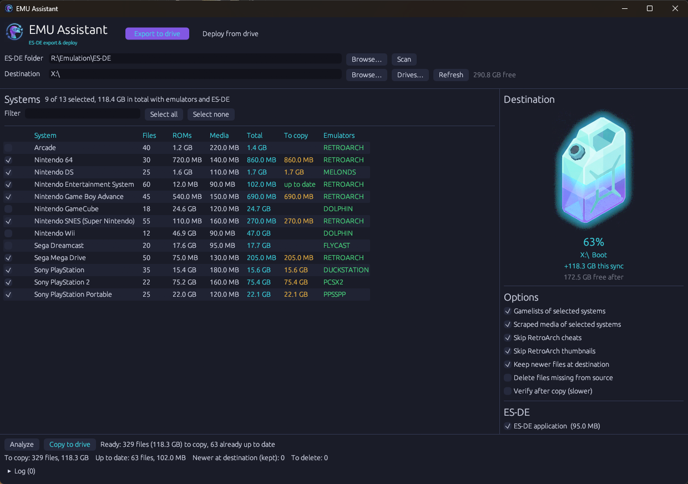
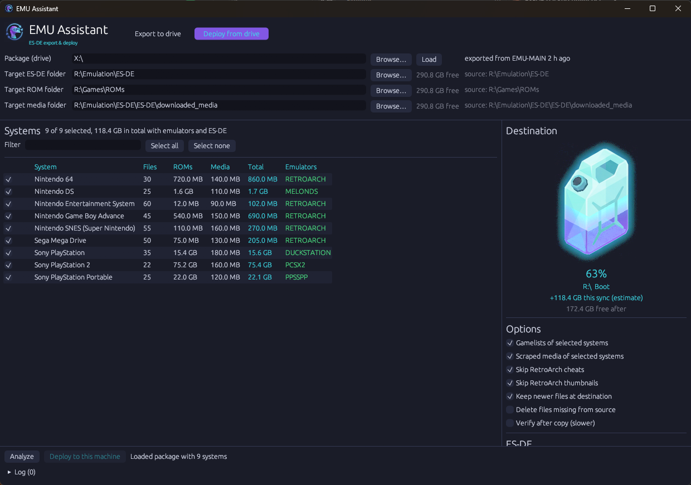
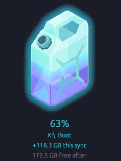
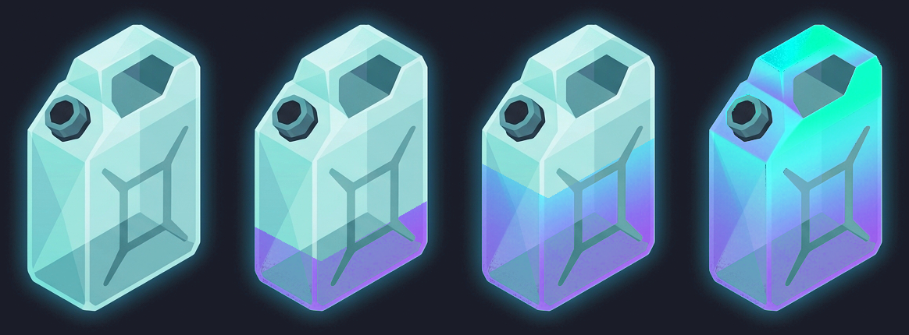
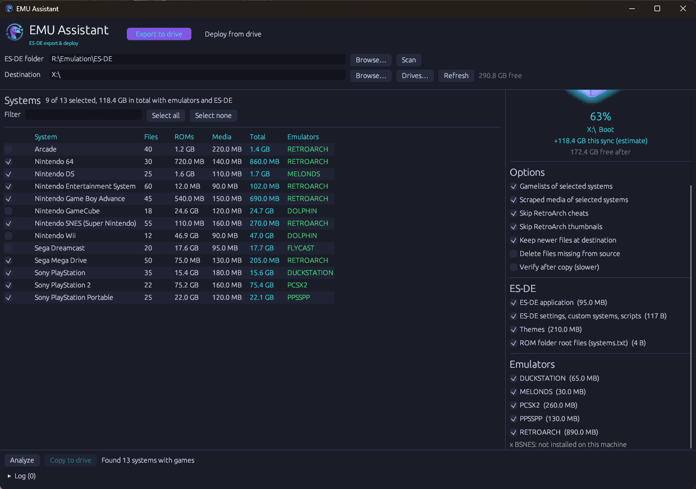

<p align="center">
  
</p>

<h1 align="center">EMU Assistant</h1>

<p align="center">
  <a href="https://github.com/chucklingkoala/EMU-Assistant/actions/workflows/build.yml"></a>
  <a href="https://github.com/chucklingkoala/EMU-Assistant/releases/latest"></a>
</p>

<p align="center">
  Pack up your <a href="https://es-de.org">ES-DE</a> setup and take it with you.<br>
  Pick the consoles you want, copy them to an external drive, then deploy them on a handheld or second PC: ROMs, emulators, BIOS, scraped media, ES-DE and all.
</p>

<p align="center">
  
</p>

---

## What it does

Say your main emulation box has terabytes of games, and your handheld (a ROG Ally, Legion Go, Steam Deck running Windows…) has room for only some of them. EMU Assistant moves that subset for you:

1. **Export:** on the main machine, tick the consoles you want. EMU Assistant works out which emulators those consoles use and copies everything to an external drive. This covers the ROMs, the emulators (with their BIOS files, configs and saves), the scraped media, the gamelists and ES-DE itself. Folder paths stay the same.
2. **Deploy:** plug the drive into the handheld and run `EMU Assistant.exe` from the drive. It copies everything into place and points ES-DE at the new ROM folder.

Copies are **incremental and resumable**. Files that are already up to date are skipped, and an interrupted copy picks up where it stopped. **Newer files at the destination are never overwritten**, so save games made on the handheld are safe.

## Features

- **Console picker** listing every ES-DE system that has games, with file count, ROM size, media size and the total space each one needs.
- **Automatic emulator detection** using ES-DE's own `es_systems.xml` and `es_find_rules.xml`. It respects the alternative emulators you picked in ES-DE, for a whole system or for individual games.
- **Fuel-can gauge** showing how full the destination drive will be after the sync, and a warning before you run out of space.
- **Mirrored paths:** `D:\Games\ROMs\snes` on the main box becomes `E:\Games\ROMs\snes` on the drive.
- **Relocatable deploy:** put ES-DE on `C:` and the ROMs on an SD card if you like. `es_settings.xml` is updated to match.
- **Safe syncing:**
  - Files are skipped when size and modified time already match.
  - Copies are written atomically, so an interrupted run never leaves a half-written file under its real name.
  - Newer files at the destination are kept, and an optional verify pass re-reads each copy.
- **Skip the bulk you don't need:** RetroArch's cheat database and its menu thumbnails can be left out. Both can be downloaded again from RetroArch's online updater.
- **Mirror mode (optional):** deletes ROMs and media at the destination that you've removed at the source. It always asks first.
- **A single small `.exe`** with no installer and no runtime. It remembers your last selection.

## Requirements

- Windows 10 or 11 on both machines.
- The **portable** release of ES-DE (the folder containing `ES-DE.exe`, with `Emulators\` next to it). The ROM folder can live anywhere: inside the ES-DE folder, or somewhere separate such as `D:\Games\ROMs`.
- An external drive large enough for your selection. NTFS is recommended. exFAT works for copying, but ES-DE itself runs slowly from exFAT (see the ES-DE user guide).

## Getting started

Download `EMUAssistant.exe` from the [latest release](https://github.com/chucklingkoala/EMU-Assistant/releases/latest) (or [build it yourself](#building-from-source)) and run it on your main emulation machine. It needs no installation.

> Put `EMUAssistant.exe` in your ES-DE folder (next to `ES-DE.exe`) and it finds your setup automatically. Otherwise, click **Browse…** and pick the ES-DE folder.

### 1. Export to the drive (main machine)


1. **ES-DE folder:** pick the folder that contains `ES-DE.exe`, then press **Scan**. Your ROM and media folders are read from ES-DE's settings, so a custom ROM path is picked up automatically.
2. **Destination:** pick the external drive with **Drives…**, or browse to a folder.
3. **Tick the consoles** you want. The **Total** column shows how much space each one needs, and the emulators they use appear on the right.
4. Press **Analyze**. EMU Assistant compares your setup with the drive:
   - The **To copy** column shows what's missing or changed; *up to date* means nothing needs copying.
   - The status bar shows the totals: files to copy, files already up to date, and newer files at the destination that will be kept.
   - The fuel can shows exactly how full the drive will be.
5. Press **Copy to drive**. You can **Cancel** at any time and run it again later; it continues where it left off.

When the copy finishes, the drive contains:

```
E:\
├── EMU Assistant.exe          ← the app, ready for the other machine
├── EMU Assistant\manifest.json← what was exported, and from where
├── Emulation\ES-DE\...        ← ES-DE, Emulators\, gamelists, media (same paths as the source)
└── Games\ROMs\...             ← only the consoles you selected
```

Exporting again later only copies what changed. Selecting more consoles adds them to the same drive.

### 2. Deploy from the drive (handheld / second PC)



1. Plug in the drive and run **`EMU Assistant.exe` from the drive**. It opens in **Deploy** mode with the package already loaded.
2. Check the **target folders**. They default to the same paths as on the main machine, but each one can be changed. For example, ROMs can go to an SD card while ES-DE stays on `C:`. Changing the ES-DE folder moves the ROM and media folders with it if they were inside it.
3. Untick any consoles you don't want on this machine.
4. Press **Analyze**, then **Deploy to this machine**.

If the ROM or media folder ends up somewhere different from the main machine, EMU Assistant updates `ROMDirectory` and `MediaDirectory` in the target's `es_settings.xml`. The original is kept as `es_settings.xml.emuasist-bak`. Start ES-DE and play.

## The fuel can

The **Destination** panel shows how full each target drive will be once the sync completes:

<p align="center">
  
  &nbsp;&nbsp;
  
</p>

- The **lower, darker liquid** is what's already on the drive.
- The **brighter, gently pulsing layer** on top is what this sync will add.
- The caption shows the fill level after the sync, how much this sync adds, and how much will be left free.
- Before you press Analyze, the numbers are an **estimate**: everything selected, as if nothing were on the drive yet. After Analyze they're exact.
- If the sync won't fit, the can turns red, shows **WON'T FIT** with the shortfall, and the copy button is disabled.
- When deploying to two drives (e.g. `C:` and an SD card), you get one can per drive.

## Options



| Option | Default | What it does |
|---|---|---|
| Gamelists of selected systems | on | Copies `ES-DE\gamelists\<system>` (game metadata, favourites, play counts). |
| Scraped media of selected systems | on | Copies `downloaded_media\<system>` (box art, screenshots, videos) for the **selected consoles only**. |
| Skip RetroArch cheats | on | Leaves out RetroArch's cheat database (tens of thousands of small files). |
| Skip RetroArch thumbnails | on | Leaves out RetroArch's own menu thumbnails. ES-DE doesn't use them. |
| Keep newer files at destination | on | Never overwrites a file that is newer at the destination, e.g. saves or configs changed on the handheld. Such files are listed after Analyze. |
| Delete files missing from source | off | Mirror mode for **ROMs and media only**. Removes destination files you've deleted at the source. Emulators and ES-DE files are never deleted. You'll see the list and must confirm. |
| Verify after copy | off | Re-reads every copied file and compares it byte for byte with the source. |

**ES-DE section:** choose whether to copy the ES-DE application itself, its settings and custom systems, your themes, custom collections, and the small files in the root of the ROM folder.

**Emulators section:** lists the emulators used by the selected consoles.
- Emulators in active use are ticked automatically. Emulators that are only configured as an alternative are shown dimmed, and you can tick them.
- Hover over an emulator to see its folder and which consoles use it.
- An emulator shown with an **x** can't be copied, and the reason is given. Usually it isn't installed, or it's a Windows component such as `cmd.exe` used for script launchers.

## What gets copied

| Item | Source | Notes |
|---|---|---|
| ROMs | `<ROM folder>\<system>` | Only the consoles you tick. |
| Gamelists | `ES-DE\gamelists\<system>` | Optional. |
| Scraped media | `ES-DE\downloaded_media\<system>` (or your custom media folder) | Optional, only for selected consoles. |
| Emulators | The emulator's folder, as found by ES-DE's find rules | The whole folder, so **BIOS files, configs, cores and saves come along**. Shared emulators like RetroArch are copied once. |
| ES-DE | The ES-DE folder | Without `Emulators\`, ROMs, media, gamelists and logs, which are handled separately. |
| ES-DE settings | `ES-DE\settings`, `custom_systems`, `scripts`, … | |
| Themes, collections | `ES-DE\themes`, `ES-DE\collections` | |

**Not copied:** consoles you didn't tick and their media; ES-DE logs; RetroArch cheats and thumbnails (unless you untick those options); emulators that resolve to Windows system folders.

Emulators that live **outside** the ES-DE folder are still copied, to the same path on the drive and target. Ones under `Program Files` are left unticked by default, because installed programs usually need their installer.

## How syncing works

- **Skip:** a file is skipped when the destination already has it with the same size and modified time. A 2-second tolerance covers FAT/exFAT timestamps.
- **Resume:** each file is written as `name.emuasist-part` and renamed only once it's complete. Cancel or unplug at any time; the next run redoes only the unfinished file and continues.
- **Newer wins:** with *Keep newer files* on, a destination file newer than the source is left alone and listed for you.
- **Long paths:** paths over 260 characters are handled.
- **Re-check:** after every copy, EMU Assistant re-analyzes automatically so the columns and gauge reflect the drive's real state.

## Tips & troubleshooting

- **An emulator shows "not installed":** ES-DE couldn't find it with its find rules either. Check that it's in the `Emulators\` folder under the name ES-DE expects (see the ES-DE user guide).
- **A system is missing from the list:** only systems with at least one game file are shown. Folders containing only `systeminfo.txt` don't count.
- **`noload.txt`:** systems that ES-DE skips because of a `noload.txt` file are flagged in the list.
- **Check what EMU Assistant sees without the GUI:**
  ```
  EMUAssistant.exe --dump "D:\Emulation\ES-DE"
  ```
  This prints the detected ROM and media folders, every system with its emulators, and where each emulator was found.
- Your last ES-DE folder, destination and selection are remembered in `%APPDATA%\EMU Assistant\config.json`.

## Building from source

Requires Rust (stable) on Windows. To embed the exe icon on the GNU toolchain, `windres` must be on `PATH`; without it the build still works but the exe uses the default icon.

```
git clone https://github.com/chucklingkoala/EMU-Assistant.git
cd EMU-Assistant
cargo build --release
# -> target\release\EMUAssistant.exe
cargo test
```

<details>
<summary>Project layout</summary>

```
src/
  main.rs            entry point, window setup, --dump
  ui.rs              egui interface, theme
  gauge.rs           fuel-can widget
  gauge_geom.rs      liquid-surface geometry for the can sprites
  scan.rs            reads an ES-DE install into systems / emulators / groups
  esde/              parsers for es_settings, es_systems, es_find_rules, gamelist.xml
  plan.rs            selection -> copy groups -> diff against destination
  sync.rs            copying (atomic .part + rename, mtime, verify, delete)
  manifest.rs        the package description stored on the drive
  deploy.rs          es_settings.xml fix-up on the target
  drives.rs          drive list and free space (Win32)
  paths.rs, fsutil.rs, config.rs
assets/              fuel-can sprites (generated)
examples/make_tank_sprites.rs   regenerates the sprites from "emu tank.jpg"
build.rs             embeds Icon/EMU Assistant.png as the exe icon
```

`cargo run --example make_tank_sprites` cuts the empty and full cans out of `emu tank.jpg` and writes a preview to `target/tank_preview.png`. To use your own artwork, replace `assets/tank_empty.png` and `assets/tank_full.png` with transparent PNGs of the same size. The liquid line is tuned in `src/gauge_geom.rs`.
</details>

## Credits

Created by [ChucklingKoala](https://github.com/chucklingkoala), developed together with [Claude](https://claude.com/claude-code) (Anthropic).

Built for [ES-DE (EmulationStation Desktop Edition)](https://es-de.org). EMU Assistant is an independent tool and is not affiliated with the ES-DE project.
